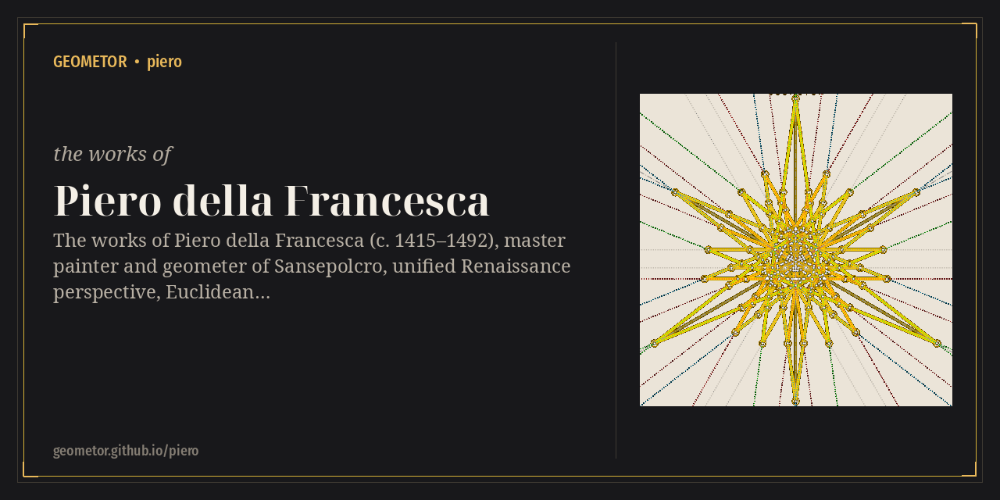

GEOMETOR • piero
================

**Visit the Online Archive:** https://geometor.github.io/piero/

**Piero della Francesca • Libellus de Quinque Corporibus Regularibus • semantic digital archive**

Mission
-------

``geometor/piero`` is part of the interconnected `GEOMETOR <https://geometor.com>`_ semantic digital archive. Piero della Francesca's mathematical masterwork unifies Renaissance perspective, Euclidean stereometry, and the arithmetic and geometric properties of the five regular polyhedra. Within this archive, Piero's treatises are liberated from isolated print bounds into addressable semantic units, calibrated vector diagrams, primary-source folio provenance, and exact symbolic formulations across the GEOMETOR corpus.

Books in This Archive
---------------------

- `On the Five Regular Bodies <https://geometor.github.io/piero/quinque_corporibus/>`_ — *Libellus de Quinque Corporibus Regularibus*, presenting critical Latin, 1509 vernacular, and complete English codex with arithmetic and geometric determinations for regular and semi-regular solids.

Repository Contents
-------------------

- ``docsrc/`` — Sphinx documentation source, book codex tracks, and scholarly apparatus compiled by `PHOTON publish <https://github.com/photon-platform/publish>`_.
- ``resources/`` — Manuscript scans, structure maps, and scholarly metadata registries.
- ``src/geometor/piero/`` — Python package and CLI tools supporting the Piero digital edition.

Local Build & Verification
--------------------------

.. code-block:: bash

   publish build
   uv run --no-sync pytest

Part of the GEOMETOR Knowledge Archive
--------------------------------------

Explore all **74 Book Codices** and **11 Mathematical Catalogs** at https://geometor.com/books/.
