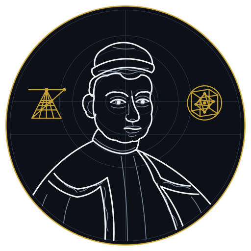

:site_title: Piero della Francesca

.. container:: author-overline

   semantic digital archive • the works of

=====================
Piero della Francesca
=====================

:person:`Piero della Francesca <piero-della-francesca>` (c. 1415–1492), master painter and geometer of Borgo Sansepolcro, bridged classical Euclidean stereometry with Renaissance perspective and abacus algebra. This archive presents his *Libellus de Quinque Corporibus Regularibus* alongside the critical Latin text, its 1509 Venetian printing by Luca Pacioli, and an English edition illuminating his polyhedral and radical calculations over :math:`\mathbb{Q}(\phi)`.

Works in This Archive
---------------------

.. container:: home-book-hero no-thumb

   .. container:: home-book-body

      .. rubric:: Cod. Urb. lat. 632 · Mancini 1915 · Venice 1509 · 4 Treatises (~140 Cases)

      **On the Five Regular Bodies (*Libellus de Quinque Corporibus Regularibus*)** — Dedicated to Guidobaldo da Montefeltro, Duke of Urbino, uniting plane polygon chords, the five Platonic solids inscribed in a sphere, mutual polyhedral inscriptions (including the icosahedron inside a cube), five truncated Archimedean solids, and the 6-edge tetrahedron volume formula.

      .. container:: home-actions

         * :doc:`Open On the Five Regular Bodies → <quinque_corporibus/index>`
         * :doc:`Latin Title Page → <quinque_corporibus/title-la>`

Key Features
------------

.. container:: home-feature-grid

   .. container:: home-feature-card

      **Three-Witness Concordance**

      Follow every treatise across Piero's Vatican autograph manuscript (``Cod. Urb. lat. 632``), Girolamo Mancini's 1915 critical Latin edition, and Pacioli's 1509 Italian printing.

   .. container:: home-feature-card

      **Abacus Algebra over** :math:`\mathbb{Q}(\phi)`

      Traces Piero's radical calculations for pentagons, dodecahedra, icosahedra, truncated Archimedean solids, and the bicylinder cross-vault volume :math:`\tfrac{2}{3}d^3`.

   .. container:: home-feature-card

      **Bridge to Pacioli & Euclid**

      Connects directly to Euclid's *Elements* Book XIII–XV and Pacioli's *De Divina Proportione*, where Piero's *Libellus* appeared as Part III in 1509.

Reference & Project
-------------------

.. container:: home-columns

   .. container:: home-col

      .. rubric:: Scholarly Apparatus

      * :doc:`People <people/index>` — Piero della Francesca, Guidobaldo da Montefeltro, Luca Pacioli, Euclid, and Girolamo Mancini
      * :doc:`Bibliography <bibliography>` — Manuscript, 1509 print, and modern critical editions
      * :doc:`Glossary <glossary>` — Renaissance Latin and abacus-algebra terminology

   .. container:: home-col

      .. rubric:: About This Project

      * :doc:`About <about/index>` — Scope, sources, and editorial methodology
      * :doc:`Using This Edition <usage/index>` & :doc:`Demos <demos/index>` — Reading guide and demonstrations
      * :doc:`Log <log/index>`, :doc:`Todos <todos/index>`, :doc:`Modules <modules/index>`, & :doc:`Changelog <changelog>` — Project journal, roadmap, and API reference

.. toctree::
   :hidden:
   :maxdepth: 2

   quinque_corporibus/index
   demos/index
   about/index
   usage/index
   todos/index
   log/index
   modules/index
   people/index
   bibliography
   glossary
   changelog
   connect
